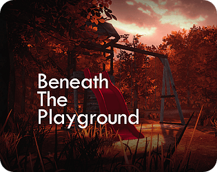

# **Profile**
**Indie Game Developer**

- 6+ years of experience in game development with Unreal Engine, recently exploring Unity
- Released 2 commercial titles

  <h1>My Games</h1>

<table align="center">
  <tr>
    <!-- Game 1 -->
    <td align="center">
      
       
      <a href="https://fexedev.itch.io/zdvihni-to" target="_blank" style="color: inherit; text-decoration: none;">
        <strong>Zdvihni To</strong>
      </a>
       
      Unreal Engine 5, Blueprints
    </td>
    <!-- Game 2 -->
    <td align="center">
      
       
      <a href="https://store.steampowered.com/app/3271950/VYJAZD/" target="_blank" style="color: inherit; text-decoration: none;">
        <strong>VYJAZD</strong>
      </a>
       
      Unreal Engine 5, Blueprints, C++
    </td>
    <!-- Game 3 -->
    <td align="center">
      
       
      <a href="https://fexedev.itch.io/beneath-the-playground" target="_blank" style="color: inherit; text-decoration: none;">
        <strong>Beneath the Playground</strong>
      </a>
       
      Unity, C#
    </td>
    <!-- Game 4 -->
    <td align="center">
      
       
      <a href="https://fexedev.itch.io/takt" target="_blank" style="color: inherit; text-decoration: none;">
        <strong>TAKT</strong>
      </a>
       
      Unity, C#
    </td>
  </tr>
</table>

****
